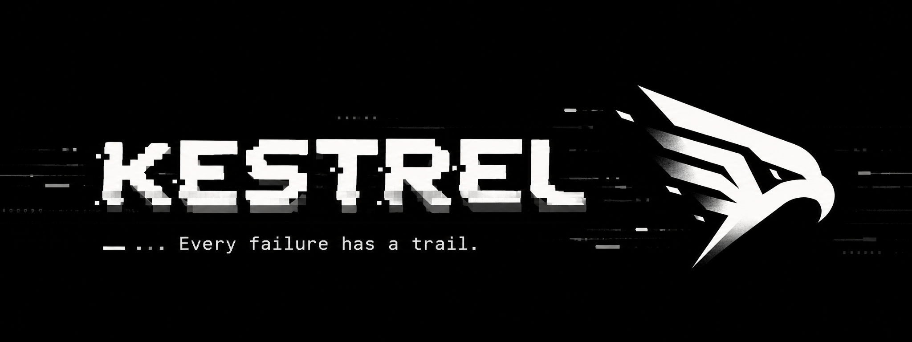

<p align="center">
  
</p>

<p align="center">
  <strong>Every dev stack failure has a trail. Stop guessing where it started.</strong><br>
  Zero-configuration incident intelligence and root-cause correlation for developers and autonomous AI agents.
</p>

<p align="center">
  <a href="https://github.com/Aareevs/Kestrel-CLI/releases"></a>
  <a href="https://github.com/Aareevs/homebrew-tap"></a>
  <a href="cmd/kestrel/main.go"></a>
  <a href="https://github.com/Aareevs/Kestrel-CLI/releases"></a>
</p>

<p align="center">
  <a href="#installation">Installation</a>
  <span>&nbsp;&nbsp;•&nbsp;&nbsp;</span>
  <a href="#quickstart">30s Quickstart</a>
  <span>&nbsp;&nbsp;•&nbsp;&nbsp;</span>
  <a href="#command--flag-shortcuts">Shortcuts</a>
  <span>&nbsp;&nbsp;•&nbsp;&nbsp;</span>
  <a href="#ai-agent-companion-kestrel-mcp">AI Agent Companion</a>
  <span>&nbsp;&nbsp;•&nbsp;&nbsp;</span>
  <a href="#why-kestrel">Why Kestrel?</a>
  <span>&nbsp;&nbsp;•&nbsp;&nbsp;</span>
  <a href="#supported-ecosystems--capabilities">Ecosystems</a>
  <span>&nbsp;&nbsp;•&nbsp;&nbsp;</span>
  <a href="#documentation--architecture">Documentation</a>
</p>

---

## Installation

Choose your preferred installation method:

### 1. Homebrew (macOS & Linux)
Install prebuilt binaries without requiring Go:
```bash
brew tap Aareevs/tap
brew install kestrel

# Or in one command:
brew install aareevs/tap/kestrel
```

### 2. Curl Script (macOS & Linux)
Automatic OS and architecture detection, integrity verification via SHA-256 checksums, and installation to `~/.local/bin`:
```bash
curl -fsSL https://raw.githubusercontent.com/Aareevs/Kestrel-CLI/main/scripts/install.sh | sh
```

### 3. PowerShell One-Liner (Windows)
Automatic architecture detection, SHA-256 checksum verification, installation to `%LOCALAPPDATA%\Programs\kestrel`, and PATH registration:
```powershell
irm https://raw.githubusercontent.com/Aareevs/Kestrel-CLI/main/scripts/install.ps1 | iex
```

### 4. Go Install (Any Platform with Go 1.26+)
Build and install from source:
```bash
go install github.com/Aareevs/Kestrel-CLI/cmd/kestrel@latest
```

### 5. Manual Release Binaries
Precompiled standalone archives (`.tar.gz` for macOS/Linux, `.zip` for Windows) and `checksums.txt` are available on the [GitHub Releases page](https://github.com/Aareevs/Kestrel-CLI/releases/latest) for macOS (Apple Silicon & Intel), Linux (x86_64 & ARM64), and Windows (x64).

---

## Quickstart

```bash
cd your-project

# 1. Inspect: Discover repository facts, dependencies, ports & health endpoints
kestrel inspect   # or: kestrel ins

# 2. Watch: Supervise processes in dependency order, auto-probe readiness, and isolate process trees
kestrel watch     # or: kestrel w

# 3. Diagnose: Pinpoint what broke first, rank root-cause hypotheses, and view next steps
kestrel diagnose  # or: kestrel diag

# 4. Verify: Continuously prove the fix holds across a 30s stability window
kestrel verify    # or: kestrel v
```

*(No configuration file? You can run any command immediately with `kestrel run -- <command>`, or generate a `kestrel.yaml` via `kestrel init`.)*

### The welcome screen

Type `kestrel` with nothing after it, in a terminal, and you get a short, static welcome: the logo, a live summary of the current project (stack, services found, whether there is a `kestrel.yaml`, how the last session went), and a few commands that fit where the project is (`kestrel init` when there is no config, `kestrel why` after a failed run, and so on). It only reads: it creates no files and runs nothing. Piped, or with `--json` / `--quiet`, bare `kestrel` prints the command list as before.

### The live status view (`kestrel watch`)

In a terminal, `kestrel watch` holds a small table of your services at the top of the screen (state, uptime, error count and the latest detail) while their logs scroll underneath. It updates as services start, pass or fail their probes, and crash. When the session ends the terminal is given back and the usual summary prints below. Anything that was on screen before is pushed into your scrollback, not erased.

It is only used when output is a terminal with room for it (about 50 columns and the table plus 6 rows). Piped output, `--json`, `--quiet`, `TERM=dumb`, a small window, and Windows get the plain log stream, and `--plain` turns it off anywhere. `kestrel run` never pins a table.

### JSON output and its schemas

`kestrel diagnose`, `timeline` and `verify` print a stable report with `--json`. Each has a JSON Schema (draft 2020-12) in [`docs/schemas/`](docs/schemas), and `kestrel schema <diagnose|timeline|verify>` prints the same file from the installed binary, for validating the output in a script or CI, or generating types:

```bash
kestrel schema verify > verify.schema.json
kestrel verify --json | check-jsonschema --schemafile verify.schema.json -
```

The schemas are generated from the Go types, and the tests check that real output from every scenario validates against them. They allow extra properties, so a field added in a later release won't break an older copy. See [docs/schemas/README.md](docs/schemas/README.md).

### Command & Flag Shortcuts

| Quick Command | Full Command | Description |
| :--- | :--- | :--- |
| `kestrel w` / `kestrel start` | `kestrel watch` | Supervise stack in dependency order with live, classified logs |
| `kestrel diag` / `kestrel why` | `kestrel diagnose` | Isolate root-cause hypotheses backed by immutable event IDs |
| `kestrel tl` / `kestrel time` | `kestrel timeline` | Chronological multi-service failure timeline |
| `kestrel v` / `kestrel check` | `kestrel verify` | Verify runtime fix across continuous stability window |
| `kestrel ins` / `kestrel info` | `kestrel inspect` | Detect technologies, service candidates, ports, and health routes |
| `kestrel r` | `kestrel run` | Wrap any command with log classification and zero config |
| `kestrel s` / `kestrel stat` | `kestrel status` | Current liveness vs. probe readiness per service |
| `kestrel sess` | `kestrel sessions` | Browse, show, or export recorded incident sessions (on its own: the list) |
| `kestrel doc` | `kestrel doctor` | Check platform, permissions, SQLite storage, and tools |
| `kestrel mcp` | `kestrel mcp` | Launch read-only stdio MCP server for AI coding agents |

**Everyday Flag Shortcuts:**
- `-j` / `--json`: Universal shorthand for JSON output across all commands (`kestrel diag -j`, `kestrel ins -j`, `kestrel s -j`, `kestrel tl -j`).
- `-a` / `--all`: Search every project's sessions (`diagnose`, `timeline`, `verify`, `sessions`).
- `-I` / `--incident N`: Just one incident of a session (`diagnose`, `timeline`, `verify`), numbered as in the report.
- `-i` / `--interactive`: Pick the session (and incident) with the arrow keys (`diagnose`, `timeline`, `verify`, `sessions show`). Terminal only: with piped input or output it says so and uses the latest session. `q`/Esc cancels (exit 130); `1`-`9` jumps to a row.
- `-s` / `--service`: A service's own recorded output (`timeline`). `-w` / `--window`: the stability window (`verify`).
- `-n` / `--name` and `-s` / `--svc`: Name the command, or add another service (`run`).
- `-v` / `--verbose`: Diagnostic logging to stderr.
- `-q` / `--quiet`: Suppress non-essential output.
- `--project <dir>`: Target a specific project directory.
- `--allow-exec`: Authorize custom test verification command checks without interactive prompt.
- `--session last`: Target the latest recorded session.
- `--no-color`: Disable ANSI styling (honors `NO_COLOR`).

---

## AI Agent Companion (`kestrel mcp`)

When AI coding agents (Claude Code, Cursor, Windsurf, VS Code) debug through raw terminal commands, they burn large shares of their context window grepping logs, parsing noise, and guessing at cascading failures.

`kestrel mcp` provides a **read-only** Model Context Protocol (MCP) server over standard stdio. Agents query pre-correlated causal graphs, ranked root-cause hypotheses, and error timelines directly instead of guessing:

```bash
# Add it to the project's MCP config (claude-code, cursor or vscode)
kestrel mcp init --client claude-code

# Or just print the entry: kestrel mcp config --client cursor
# Or by hand, with Claude Code:
claude mcp add kestrel -- kestrel mcp --project /path/to/your/project
```

### Supported MCP Tools

| Tool | Description |
| :--- | :--- |
| `get_diagnosis` | Ranked hypotheses per incident with supporting/contradicting event IDs and actionable next steps |
| `get_failure_timeline` | Structured incident timeline, dependency graph, and historical verification results |
| `get_recent_errors` | Most recent error and fatal events with secret redaction applied |
| `get_session_summary` | Session state, event counts, probe results, and notable lifecycle events |
| `get_verification_results` | Past and active `kestrel verify` reports |
| `get_service_status` | Current liveness and readiness state across supervised services |
| `list_services` | Configured service manifests with secrets masked |
| `inspect_project` | Static technology discovery findings and inferred dependencies |
| `list_sessions` | This project's recorded sessions, newest first, to pick a session id from |
| `search_events` | Find recorded events by text, service, type or severity (plain substring, not a pattern) |
| `validate_config` | Check `kestrel.yaml` and list every problem with its line number |

- **Strictly Read-Only**: The MCP server never starts, stops, or signals processes.
- **Zero-Trust Log Handling**: Log text is delivered as data, never instructions.
- **Pre-Redacted**: All tokens, API keys, JWTs, and database URLs are redacted before reaching the agent.

---

## Why Kestrel?

| Capability | Kestrel | Standard Shell / Logs | Docker Compose Logs | LLM Reading Raw Logs |
| :--- | :---: | :---: | :---: | :---: |
| **Zero-Config Execution** | **Yes** | Yes | No (requires compose) | Yes |
| **Causal Root-Cause Attribution** | **Yes (Graph + Ports)** | No | No | No (guesses on timing) |
| **Clean Process Containment** | **Yes (Zero Orphans)** | No (leaves orphans) | Yes (containers only) | No |
| **Multi-Sample Stability Window** | **Yes (Continuous)** | No | No | No |
| **Automatic Secret Redaction** | **Yes (Pre-storage)** | No | No | No |
| **Bounded Memory Under Floods** | **Yes (Ring Buffers)** | No (hangs terminal) | No (fills disk) | No (token overflow) |
| **Read-Only MCP Server** | **Yes (Native stdio)** | No | No | No |
| **Offline & Private** | **Yes (100% Local)** | Yes | Yes | No |

---

## Supported Ecosystems & Capabilities

<p align="center">
  
</p>

| Stack | Detected From | Support Level |
| :--- | :--- | :---: |
| **Node.js**: Vite, Next.js, Nuxt, Astro, SvelteKit, Expo / React Native, Express, NestJS… | `package.json` scripts, lockfiles, `vite.config.*`, proxies | Full |
| **Go**: gin, echo, fiber, chi, net/http | `go.mod`, `main.go`, health routes in code | Full |
| **Docker Compose** | services, published ports, `depends_on`, build contexts | Full |
| **Python**: Django, FastAPI, Flask (pip, uv, Poetry, Pipenv) | `manage.py`, `pyproject.toml`, `requirements.txt` | Standard |
| **Java**: Spring Boot (Maven, Gradle) | `pom.xml`, `build.gradle(.kts)`, `application.properties` | Standard |
| **Ruby**: Rails, Sinatra | `Gemfile` | Standard |
| **PHP**: Laravel | `composer.json`, `artisan` | Standard |
| **Rust**: axum, actix-web, rocket, warp | `Cargo.toml`, `src/main.rs` | Standard |
| **.NET**: ASP.NET Core, worker services, console apps | `*.csproj` / `*.fsproj`, `Properties/launchSettings.json`, `appsettings.json` | Standard |
| **Elixir**: Phoenix, Plug (Bandit, Cowboy) | `mix.exs`, `config/dev.exs`, `config/runtime.exs` | Standard |
| **Deno**: Fresh, Oak, Hono, `Deno.serve` | `deno.json(c)` tasks, `Deno.serve` entry files | Standard |
| **Monorepos**: pnpm, npm, yarn and Bun workspaces; Go workspaces; Cargo workspaces | `pnpm-workspace.yaml`, `package.json` `workspaces`, `go.work`, `[workspace]` in `Cargo.toml` | Standard |
| **Bun**: Elysia, `Bun.serve` | `package.json`, `bun.lock(b)`, `bunfig.toml`, `index.ts` entry files | Standard |

Detection (above) is separate from diagnosis: `kestrel diagnose` recognizes failures from the output itself, whatever
the stack. That includes Java and Kotlin (Spring Boot, JDBC, Maven/Gradle), Rust (panics, cargo), .NET (unhandled
exceptions, Kestrel, MSBuild), Ruby and Rails, PHP and Laravel, and Docker and Compose (daemon, ports, images,
builds, the compose file, container exits): crashes, port and database failures, missing code, and build and test
failures. You can add your own shapes in `kestrel.yaml`. See
[docs/events.md](docs/events.md).

---

## Documentation & Architecture

- **[Architecture & Engine Design](docs/architecture.md)** — Package structure, supervision pipelines, and storage lifecycle.
- **[Diagnosis Rules Catalog](docs/diagnosis-rules.md)** — Comprehensive catalog of incident correlation rules and evidence requirements.
- **[Verification Specification](docs/verification.md)** — Continuous stability window algorithm and verification verdicts.
- **[MCP Server Reference](docs/mcp.md)** — Tool schemas and agent configuration guides for Cursor, Claude, and VS Code.
- **[Configuration Guide](docs/configuration.md)** — Complete schema documentation for `kestrel.yaml`.
- **[Security & Privacy Model](docs/security.md)** — Threat model, redaction rules, and process execution safeguards.
- **[Releasing Guide](docs/releasing.md)** — GoReleaser workflows, checksums, and Homebrew tap management.

---

## Contributing

Contributions are welcome: error patterns, diagnosis rules, ecosystems for `inspect`, and bug reports. Read
[CONTRIBUTING.md](CONTRIBUTING.md) first (it has the design rules and how to add each kind of thing), and follow
the [Code of Conduct](CODE_OF_CONDUCT.md). Report security issues privately, as described in
[SECURITY.md](SECURITY.md).

## License

MIT License. Copyright (c) 2026 Aareevs. See [LICENSE](LICENSE) for details.
